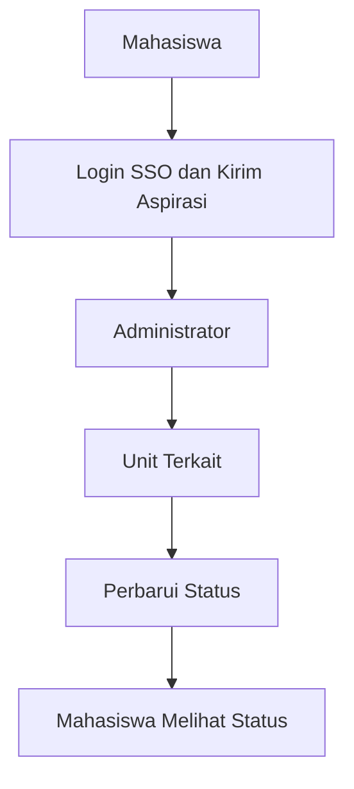

# Rancangan Arsitektur SUARA-TI

## 1. Kebutuhan Terpilih dan Asumsi

### 1.1 Kebutuhan terpilih

SUARA-TI adalah aplikasi berbasis web untuk penyampaian dan pengelolaan aspirasi mahasiswa di Fakultas Sains dan Teknologi (FST). Rancangan ini berfokus pada kebutuhan berikut:

1. **Login mahasiswa:** mahasiswa masuk menggunakan SSO kampus.
2. **Pengiriman aspirasi:** mahasiswa dapat menulis dan mengirimkan aspirasi melalui formulir.
3. **Pilihan identitas publik:** mahasiswa dapat memilih agar identitasnya tidak ditampilkan kepada pengguna luar yang mengakses website. Identitas tetap dapat diketahui administrator.
4. **Pelacakan status:** mahasiswa dapat melihat perkembangan aspirasi, dengan status *Belum ditindaklanjuti*, *Sedang ditindaklanjuti*, atau *Selesai*.
5. **Pengelolaan aspirasi:** administrator dapat melihat dan mengategorikan aspirasi, lalu meneruskannya kepada unit terkait.
6. **Tindak lanjut unit terkait:** unit yang menerima aspirasi dapat memprosesnya dan memperbarui status.
7. **Rekap aspirasi:** data aspirasi dapat direkap untuk membantu pengelolaan dan evaluasi.

### 1.2 Asumsi dan hal yang perlu dikonfirmasi

- **Cakupan sistem:** hanya FST, sesuai keputusan pemilik kebutuhan.
- **Anonimitas:** “anonim” berarti identitas tidak ditampilkan kepada pengguna luar/publik, bukan disembunyikan dari administrator. Rancangan ini tidak menganggap pengiriman aspirasi benar-benar anonim terhadap pengelola.
- **SSO kampus:** diasumsikan tersedia dan dapat diintegrasikan oleh aplikasi. Ketersediaan teknis serta mekanisme integrasinya perlu dikonfirmasi dengan pengelola SSO kampus.
- **Hak akses unit:** diasumsikan setiap unit hanya dapat melihat dan memproses aspirasi yang diteruskan kepadanya. Aturan akses pastinya perlu disepakati.
- **Status aspirasi:** digunakan tiga status yang tercantum dalam dokumen tugas: belum ditindaklanjuti, sedang ditindaklanjuti, dan selesai.
- **Penerusan aspirasi:** administrator menentukan kategori dan unit tujuan, lalu meneruskan aspirasi ke unit tersebut.
- **Notifikasi:** tidak dimasukkan sebagai fitur karena belum dinyatakan sebagai kebutuhan dalam dokumen.
- **Teknologi implementasi:** bahasa pemrograman, framework, DBMS, dan infrastruktur belum ditentukan.

## 2. Daftar Modul dan Tanggung Jawab

| Modul | Tanggung jawab |
|---|---|
| Antarmuka Web | Menyediakan halaman login, formulir aspirasi, pilihan tampilan identitas, tampilan status, serta halaman pengelolaan sesuai peran pengguna. |
| Autentikasi dan Hak Akses | Mengintegrasikan login SSO dan membatasi akses berdasarkan peran: mahasiswa, administrator, dan unit terkait. |
| Pengelolaan Aspirasi | Memvalidasi dan menyimpan aspirasi, menghubungkan aspirasi dengan pengirimnya, serta mencatat pilihan apakah identitas ditampilkan kepada publik. |
| Kategorisasi dan Penerusan | Memungkinkan administrator mengategorikan aspirasi, menentukan unit tujuan, dan meneruskannya kepada unit tersebut. |
| Tindak Lanjut dan Status | Memungkinkan unit terkait memperbarui status aspirasi dan menyimpan perubahan status. |
| Tampilan Publik | Menampilkan informasi aspirasi yang memang diizinkan untuk publik, tanpa menampilkan identitas pengirim jika opsi identitas tersembunyi dipilih. |
| Rekap dan Pelaporan | Menyediakan rekap data aspirasi untuk membantu administrator atau pihak berwenang melakukan evaluasi. |
| Basis Data | Menyimpan data akun/referensi identitas, aspirasi, kategori, unit tujuan, status, dan riwayat perubahan yang diperlukan. |

## 3. Diagram Arsitektur dan Label Hubungan

**Label hubungan:** Mahasiswa mengirim aspirasi → administrator mengategorikan dan meneruskan → unit terkait menindaklanjuti dan memperbarui status → mahasiswa melihat status terbaru.

Diagram ini merupakan alur hubungan utama yang disederhanakan untuk dijadikan gambar diagram. SSO kampus digunakan pada proses login.

Diagram sederhana ini menunjukkan alur utama dari pengiriman aspirasi hingga mahasiswa melihat status terbaru.

## 4. Alur Satu Fitur: Pengiriman Aspirasi

### Alur normal

1. Mahasiswa membuka SUARA-TI.
2. Sistem mengarahkan mahasiswa untuk login melalui SSO kampus.
3. SSO mengembalikan hasil autentikasi. Jika berhasil, mahasiswa masuk ke aplikasi.
4. Mahasiswa mengisi formulir aspirasi dan memilih apakah identitasnya boleh ditampilkan kepada publik.
5. Sistem memvalidasi isian.
6. Jika valid, sistem menyimpan aspirasi beserta hubungan ke akun pengirim dan pilihan tampilan identitas.
7. Aspirasi muncul pada daftar pengelolaan administrator.
8. Administrator menentukan kategori dan unit tujuan, lalu meneruskan aspirasi.
9. Unit terkait memproses aspirasi dan memperbarui status.
10. Mahasiswa dapat melihat status terbaru. Jika identitas disembunyikan, identitas tetap tersedia bagi administrator tetapi tidak ditampilkan kepada publik.

### Satu kondisi gagal

**Kondisi:** mahasiswa gagal login melalui SSO, misalnya autentikasi ditolak atau layanan SSO tidak dapat dihubungi.

**Perilaku sistem yang diharapkan:**
- Sistem tidak membuat sesi login dan tidak mengizinkan pengiriman aspirasi.
- Sistem menampilkan pesan bahwa login belum berhasil dan meminta mahasiswa mencoba kembali.
- Aspirasi tidak disimpan sebagai pengajuan yang berhasil.
- Kegagalan dicatat secukupnya untuk keperluan diagnosis tanpa menyimpan kata sandi atau rahasia autentikasi.

## 5. Dua Keputusan Desain dan Alasannya

### Keputusan 1 — Identitas disimpan, tetapi tampilan identitas dikendalikan terpisah

**Keputusan:** data pengirim tetap terhubung ke aspirasi di dalam sistem, sementara pilihan “tampilkan identitas kepada publik atau sembunyikan” disimpan sebagai pengaturan terpisah. Hak melihat identitas dibatasi berdasarkan peran.

**Alasan:**
- Sesuai klarifikasi bahwa anonimitas berlaku terhadap pengguna luar/publik, bukan administrator.
- Administrator tetap dapat mengelola dan menindaklanjuti aspirasi dengan mengetahui pengirimnya.
- Sistem dapat menyembunyikan identitas dari tampilan publik tanpa kehilangan hubungan internal antara aspirasi dan akun pengirim.

**Implikasi:** akses ke identitas harus dibatasi dan diuji. “Disembunyikan dari publik” tidak boleh dipromosikan sebagai anonim sepenuhnya.

### Keputusan 2 — Administrator menjadi perantara penerusan aspirasi ke unit terkait

**Keputusan:** aspirasi yang masuk dikelola administrator terlebih dahulu; administrator mengategorikan dan meneruskannya kepada unit terkait. Unit kemudian memperbarui status tindak lanjut.

**Alasan:**
- Sesuai kebutuhan administrator untuk mengategorikan dan meneruskan aspirasi.
- Memberi alur pengelolaan yang terstruktur dibandingkan aspirasi yang tersebar melalui chat atau formulir terpisah.
- Memperjelas tanggung jawab: administrator mengatur penerusan, sedangkan unit terkait menangani tindak lanjut.

**Implikasi:** perlu aturan yang jelas untuk menentukan unit tujuan dan memastikan aspirasi tidak berhenti tanpa pembaruan status.

---

## Catatan batas rancangan

Rancangan ini dibuat dari dokumen tugas RPL dan klarifikasi pengguna. Detail teknis yang belum diputuskan—termasuk teknologi aplikasi, struktur basis data final, kebijakan retensi data, dan mekanisme integrasi SSO—tidak dianggap sudah ditetapkan.
